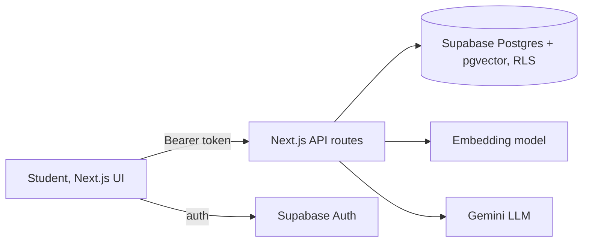

# GapFinder AI

Upload your syllabus, notes and past papers. GapFinder maps them into topics, quizzes you from your own material, **diagnoses weak, medium and strong topics**, and builds a revision plan that updates as you improve. Chat is a supporting feature; the main output is the diagnosis.

**Live app:** `<your-vercel-url>`  |  **Demo login:** `demo@gapfinder.app` / `Demo@12345` (sample Class 11 Physics material preloaded)

## Problem statement
Students revise what they already know and skip what they don't, because nobody tells them where they stand and they can't ask about a gap they don't know exists. Existing tools only answer questions on request. GapFinder finds the gap first.

## Features (all 8 from the brief)
| Feature | Where |
|---|---|
| Material upload (PDF, TXT, MD) | `app/api/ingest`, Material tab |
| Topic map from syllabus | `lib/ingest.ts` |
| Diagnostic quiz with source citation per question | `app/api/quiz` |
| Gap report: weak/medium/strong with reasons | `app/api/report` |
| Personalized revision plan from available time | `app/api/report` |
| Explain-This-Topic assistant (cited, refuses off-material) | `app/api/chat` |
| Progress dashboard across attempts | `app/api/dashboard` |
| Auth + per-user data (Supabase Auth, Postgres RLS) | `lib/server.ts`, `supabase/schema.sql` |

## Setup
1. Create a Supabase project. In the SQL editor run `supabase/schema.sql`.
2. Get a Gemini key from https://aistudio.google.com/apikey.
3. `cp .env.example .env.local` and fill the values.
4. `npm install`
5. `npm run seed` creates the demo user and loads the sample material (`scripts/sample/`).
6. `npm run dev`, then open http://localhost:3000.
7. Deploy: push to GitHub, import in Vercel, add the same env vars (the service role key is only needed locally for seeding).

If you change `EMBED_MODEL`, keep it at 768 dimensions or change `vector(768)` in the schema.

## Architecture

## RAG pipeline
1. **Extract:** `unpdf` per page for PDFs, plain text otherwise. Page numbers are kept.
2. **Chunk:** ~1800 characters (~450 tokens), 250 overlap, split per page, ends on sentence boundaries (`lib/chunk.ts`).
3. **Embed:** `gemini-embedding-001` at 768 dims, stored in `chunks.embedding` with an HNSW cosine index.
4. **Retrieve:** `match_chunks()` SQL function, cosine similarity, top-k, scoped to the user and to notes/past papers (never the syllabus).
5. **Generate:** the LLM receives only the retrieved passages, numbered, and must return which passage each question or answer came from.

## AI workflow and how retrieval and generation stay separate
| Step | Retrieval (no LLM text) | Generation (LLM) | Plain code |
|---|---|---|---|
| Topic map | | syllabus text to topic JSON | |
| Quiz | top-4 chunks per topic | 2 MCQs from those chunks only, with `source` index | validation, `source_chunk_id` stored |
| Answer check | | explains why the chosen option is wrong, using the source chunk | **correct/incorrect is a plain index comparison** |
| Gap analysis | | writes the reason from the actual missed questions | **scores and thresholds (weak <40%, medium 40-70%, strong >70%)** |
| Plan | | words the tasks | **time allocation and day scheduling** |
| Assistant | top-5 chunks | answers from them with citations | **refuses when best similarity < 0.4** |

Grounding guards: every question stores its `source_chunk_id` and the UI shows the passage; topics with no sufficiently similar chunk (<0.35) are reported as "not enough material" instead of getting invented questions; the assistant says "Not found in your uploaded material" rather than guessing.

## Checking quality
`npm run eval` runs 10 questions against the sample material and prints the top-3 retrieval hit rate. Record your result here after running it: **Top-3 hit rate: _/10**. Tune `MIN_TOPIC_SIM` and `MIN_CHAT_SIM` in `lib/server.ts` using it.

## Limitations
- Text-based PDFs only (no OCR for scans). MCQ only; no free-text grading.
- Reasons and task wording depend on LLM quality; scores themselves are deterministic.
- A diagnosis from 2 questions per topic is a coarse signal; more attempts sharpen it.
- Quiz generation runs per topic in parallel and may hit free-tier rate limits on large syllabi.

## Future enhancements
Class-level teacher analytics, parent progress tracking, multi-subject and multi-language support, spaced-repetition reminders, LMS integration, OCR, adaptive follow-up questions on weak topics.
